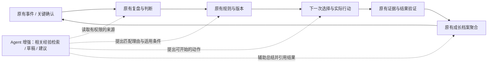
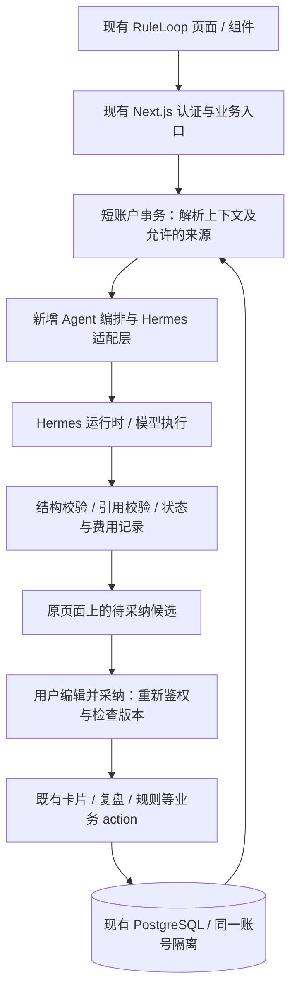

# RuleLoop AI Agent 叠加方案

更新时间：2026-10-31。状态：根据用户纠偏整理的待评审方案；本文不代表 Agent 已接入、界面已确认或已部署。

## 1. 产品基线与本次纠偏

用户最新要求：在 RuleLoop 原有方案和架构之上叠加 AI Agent。原有的事件、关键确认、复盘、规则、验证证据和成长档案继续构成产品主线。SE422 是验证能力的一个案例，不是把 RuleLoop 改造成学习平台的依据。

基线以当前根目录账号应用及 [README](../README.md)、[账号版架构](ARCHITECTURE.md) 为准。旧 SQLite 原型、早期验证卡规划、独立官网与学习原型不取代当前应用。当前首页的“主线任务”来自关键确认，不等于所有模块的统一任务调度器。

此前独立 v7 预览不作为已接受的产品或架构基线：用户未确认流程，并已明确指出偏离。其材料定位、引用校验、草稿保护和实际行动区分可以作为设计经验；独立应用、认证、业务数据层和学习导航不整体移入 RuleLoop。既有已授权的基础修复保留，本次不自动回滚或清理用户数据。

**本次增量：让 RuleLoop 在原有节点上读懂当前处境、调取相关过往、提出有出处的建议，并把采纳及后续结果留在原有闭环中。**

## 2. 已有能力与真实缺口

以下为本次读取本地代码确认的情况，不等同于线上验收结果。

| 现有能力 | 代码依据 | 缺口与叠加方式 |
|---|---|---|
| 事件记录、复盘、同场景案例、规则关联 | `src/app/actions/event-library.ts` | 已能拼接结构化上下文，但尚未由 Agent 基于来源进行分析；扩展既有上下文构建 |
| 事件详情“用 GPT 分析” | `src/components/event-context-actions.tsx` | 目前只生成文本，没有调用模型；这里是首个 Agent 入口，而非另开学习主页 |
| 五问复盘／风险信号、决策点、下次行动 | `src/components/mini-review-form.tsx` | AI 协助整理草稿和指出遗漏，用户继续使用原表单确认；AI 推断不冒充用户判断 |
| 统一卡片 | `src/components/card-container.tsx`、`src/app/actions/cards.ts`、`src/lib/card-types.ts` | 复用风险、复盘、行动、笔记等类型；当前只在部分页面挂载，不能宣称已经覆盖全站 |
| 规则、版本、触发选择、结果验证 | `src/app/actions/rules.ts`、`src/app/actions/experience-trigger.ts` | AI 推荐匹配理由与修订候选，继续遵守已有状态迁移和用户验证 |
| 关键确认的证据与复盘 | `src/app/actions/evidence-review.ts` | AI 帮助检查缺失证据和准备最小动作，实际结果仍由原业务入口记录 |
| 消费评估导出、外部分析、最终决策、补救行动 | `src/app/actions/spending-review.ts` | 后续可把复制粘贴分析升级为站内 Agent；最终决策仍使用原流程 |
| 成长档案 | `src/app/actions/archive.ts`、`src/app/archive/page.tsx` | 当前为实时聚合，不建档案主表；AI 做可回溯摘要，不建立另一份事实档案 |
| 任务与资源 | `src/app/actions/tree-tasks.ts`、`src/app/actions/resources.ts` | 未来将学习准备和材料接入现有任务、资源体系；需逐个适配，不假定全模块已贯通 |
| 账号与数据库 | `src/lib/action.ts`、`src/db/index.ts` | 沿用 Better Auth、账户事务、RLS 和现有 PostgreSQL；不增加一套 Agent 登录态 |

现有卡片的 `active/done/archived` 是业务展示状态，不能用它表示“AI 建议已经被确认”或“规则已经证明有效”。成长档案当前统计也有具体业务口径，不能把一次生成、点击或草稿保存计成改善。

## 3. AI 在原有闭环中的位置

优先采用情境入口：用户在处理当前事件、复盘或决策时获得帮助。首页原有主线、模块导航、页面层级与 HUD 视觉保持为设计基线；是否增加全局聊天入口留到情境能力证明价值之后。所有页面改动仍要按仓库 Design-First 流程制作原页面上的高保真增量并评审。

Agent 与普通一次性聊天的差异是：能带着当前业务上下文找回用户的相关过往，区分经验适用与失效的条件，辅助做出下一步，再读取后来真实发生的结果修正建议。

## 4. 首版 P0：增强现有事件分析，不重建主流程

### P0-1：查回与本次相关的经验

从事件详情现有“用 GPT 分析”位置进入。以当前事件和已有复盘为起点，先取同场景案例、相关规则及其来源和验证结果；首版使用可解释的过滤和排序，不先引入向量数据库或把整个账号资料全部送出。

返回内容控制为三部分：

1. **你可能又遇到了什么**：当前事实、类似过往、两者的关键差异。没有足够依据时明确说不确定。
2. **哪条经验值得参考**：来源链接／原文片段、用户自述或实际验证的证据性质、适用条件与不适用条件、当前是否满足。
3. **现在可以做什么**：一个具体动作、预计投入及可观察产物；可编辑、忽略、暂缓，也可说明“这次不适用”。

示例仅用于说明产品行为，不是数据库事实：用户再次因同类事件受损，Agent 指向已记录的那次复盘和规则，说明共同条件及差异，建议先完成一个实际检查，并允许用户保存为当前事件下的行动卡。不能虚构历史次数、损失金额、课程资料、考试分数或老师要求。

### P0-2：采纳后回到已有对象

分析结果先作为候选显示，不自动保存为用户事实。用户编辑并采纳后：补充说明进入原事件的笔记／风险／行动卡；规则建议进入已有候选／规则保存路径；复盘草稿进入现有复盘表单，继续由用户提交。不同操作分别适配既有业务 action，不能把任意文本统一冒充“规则”。

采纳记录应关联运行与目标对象，区分采纳、执行和有效；重复点击只产生一次业务写入。候选可被拒绝，拒绝不算用户失败，也不自动删除历史经验。规则生效与版本变更仍经过原有约束。

### P0-3：用原有结果记录修正经验

用户按原流程填写证据、结果或复盘；Agent 可整理结果草稿并建议保留、修订或暂停经验。实际动作和产出属于原业务记录，运行日志只记录关联，不另建一套权威“Agent 行动事实”。没有结果就保持未知，不能把“点开始”“看过建议”“交了作业”算成“建议有效”或“学会”。

经验来源被修改、删除、归档，或规则已经变更时，重新采纳前检查状态并提示变化。旧引用不能继续被当作当前有效依据。

### 首版验收

- 从原事件详情发起，在同一页面查看结果和来源，原复盘、规则及导航仍可正常使用。
- 用户能解释“为什么是这条历史经验、为什么这次适用”；无来源的结论明确为待确认推断。
- 用户可直接编辑建议并保存到正确的既有业务对象，刷新后可查到；重复提交不重复创建。
- 至少用真实的重复事件与反例各走通一次：反例可拒绝、不适用可保留，后续结果能更正先前建议。
- 缺配置、模型超时、非法引用、源记录变化或取消时，输入保留，原有人工操作继续可用；失败不悄悄收费重试。
- 评估重点是建议后是否发生有证据的行动，以及后续是否更充分／减少重复遗漏；生成量、聊天时长、点击数只用于排障，不作为产品成功指标。

## 5. 优先级与后续范围

| 优先级 | 交付 | 为什么先做／依赖 |
|---|---|---|
| P0 前置 | 现有事件页、复盘、卡片、规则和验证的字段／写入链路核对；在原页面制作增量高保真 | 验证改动确实叠加在原架构，先解决入口与保存位置的歧义 |
| P0 | 上述事件内检索、来源与适用条件、建议编辑采纳、原结果回流 | 最小范围证明“过往教训指导当下”，避免全站同时改造 |
| P1 | 扩展关键确认与消费决策：准备清单、历史风险、站内外部分析 | 各自复用已有确认、冷静期、最终决策及补救行动；沿用同一个 Agent 服务 |
| P1 | 成长档案中的跨事件模式摘要 | 基于底层记录，可下钻、有反例，摘要不取代原始档案与统计 |
| P1 | 学习案例接入现有任务／资源：材料定位、草稿协助、开始准备 | SE422 在原模型中作为一个场景；材料先有实际来源，不生成虚假页码与课程要求 |
| P2 | Canvas／学校信息连接、跨模块提醒与定时 Agent | 需要确认学校接口权限、时间及时区、去重和提醒渠道；目前未定项继续保留 |
| P2 | 更广的持续检索与调度、语义召回、可选全局对话 | 以真实漏检或行动成本证明需求后再增加，避免先堆基础设施 |

保留中／英／泰支持要求：源文与源语言保留，输出可按用户语言呈现；ID、时间、数值与条件在翻译后不改变，语言切换不重复产生业务对象。首版范围内必须提供三语关键状态、候选操作和错误反馈的验收，不把当前仅有的中英界面误报为已完成三语。

保留 USD／CNY／THB 的 API 费用呈现与结算诉求，区分提供商实际账单币种、参考换算和用户实际支付。提醒渠道、课程和预算仍待定；没有预算和调用授权前不进行真实付费调用。多币种业务金额换算不等于模型计费或支付已实现。

## 6. Hermes 在现有工程中的位置

以下为提议的边界，不宣称已验证 Hermes 的具体接口或原生能力。适配层契约先以本地受控响应验收，实际 Hermes 端点／传输方式由固定版本的官方能力检查决定。

- 复用 `getUserId`、`withAccountDatabase`、现有表与账户隔离。Hermes 通过受控工具／适配层获得最小上下文，不能任意访问原始数据库或其他账户。
- 现有 `withAccount` 包裹整个账户事务并有账户级锁。模型网络等待放在事务之外：短事务读取快照并登记运行 → 事务外调用 → 短事务校验与保存候选。采纳时再次确认对象归属、版本与业务状态。
- 建议增加 `src/lib/agent/`，承载上下文结构、来源解析、输出协议、提示词版本、Hermes 适配与编排；`src/app/actions/agent.ts` 只做鉴权、输入验证和业务协调。路径是规划，尚未创建实现。
- 允许为异步状态、失败恢复、审计与费用新增技术性的 `ai_runs` 等记录，位于原数据库并补齐迁移、归属、RLS、保留及删除策略。需要耐久存储的引用、采纳映射另做字段／关系设计；不把任意运行 JSON 塞进卡片正文，也不为避免加表而破坏业务结构。
- 现有卡片、规则和资源的字段未必能完整保存出处与适用条件。实施时逐个确认：已有字段能表达的直接复用，缺失的通过兼容迁移补齐，并提供稳定来源关联；不能只显示一段来源文字就宣称可溯源。
- 密钥留在服务端；明确超时、取消、幂等、输出长度和预算。调用超时不等于提供商没有计费，重试前核对请求状态，禁止无限自动重试。
- 原有确定性校验和规则匹配继续作为基础；AI 无法返回有效建议时，仍能导出上下文、手工复盘、编辑规则与提交证据。

## 7. 提示词与可验证输出

提示词服务原有业务动作，不使用一个无限扩张的“全能导师”提示词。输入分为当前业务事实、可引用历史片段、现有规则及版本、验证与反例、当前用户约束、目标语言和允许操作。

核心约束：事实必须引用服务端提供的 source ID；明确区分用户自述、已记录结果和 AI 假设；不根据单次失败给用户贴人格标签；不把痛苦经历用于羞辱或强制督学。引用原文保留含义，学到的经验必须写出条件，证据不足时可以返回没有可靠匹配。

首版结构化输出建议包含：

| 字段 | 用途 |
|---|---|
| `observations` | 带来源的事实，以及单独标注的推断 |
| `relevantLessons` | 来源 ID／片段定位、规则版本、相似点与差异、适用／排除条件、证据局限 |
| `nextAction` | 用户能开始的一个动作、产物、投入估计与待确认信息 |
| `drafts` | 对应现有业务对象的可编辑候选，不执行写入 |
| `unknowns` | 无法由现有资料确定的内容，不伪造补齐 |

模型不能自行生成可信来源。服务端按本次允许来源集合校验 ID、权限、片段和版本，过滤无法定位的引用。资料内嵌的指令仅是资料内容，不获得工具权限。对缺数据、跨场景误用、失效规则、矛盾证据和用户拒绝建立回归案例。

## 8. 本地发现的前置问题与未完成边界

- 事件详情目前用 `event_case` 作为卡片上下文，卡片 action 的事件刷新分支与数据库归属触发器使用 `event`。现已在隔离 PostgreSQL 中使用实际迁移函数复现：当前命名在关联非空事件时被 `23503` 拒绝，统一为 `event` 可通过归属检查。两处替换的最小补丁已准备但未应用，历史数据和线上影响仍需核对。[真实链路核验与补丁](agent-audit/2026-10-31/README.md)
- 当前规则匹配可因领域相同而召回，不能直接视为满足适用条件；现有事件文本上下文也未完整带出关联主规则版本与验证证据。Agent 上下文需要在原查询之上补齐来源读取，保留案例候选规则和主规则的类型区别。具体证据及实现顺序见上述核验。
- 已准备 [原架构上下文与分析候选](agent-audit/2026-10-31/context-candidate/README.md)，复用原账户事务与查询，补齐来源、内容快照、当前及历史版本反馈，以及提示词和返回校验。66 项候选检查及类型检查已通过；补丁仍未采用，不能作为真实 Hermes 或生产接入证明。
- 当前档案聚合的“改善次数”等有特定业务口径，不能当作覆盖全部学习和人生场景的统一成效指标。
- 当前 GPT 文本出口不是已接入模型；翻译 Gateway 的存在也不意味着 Hermes 已接入。此前基础补丁及隔离候选的测试结果不代表此次方案已在生产通过。
- 本文完成的是架构与范围纠偏。未修改生产 UI、业务代码、数据库或部署；真实 Hermes、付费调用、生产迁移与学校账号连接均未在本次执行。

## 9. 原页面增量设计预览（待用户评审）

已制作 [原页面增量设计预览](design/agent-overlay/README.md)，直接读取现有事件详情、导航、按钮和卡片流组件生成静态基线，保留当前 CSS 和本地字体。使用只读看到的“vibe coding 5h”事件副本，演示同页分析、原文溯源、草稿编辑、采纳为行动卡及关联复盘卡；没有另建首页、档案或任务体系。

界面和交互仍待用户评审。`design/agent-overlay/verification.json` 仅记录静态原型的交互校验，不代表真实 Agent、跨事件检索、三语、数据库写入或线上验收已经完成。Agent 响应为人工编写情景，所有保存仅在原型浏览器本地；生产组件和业务 actions 未修改。

按仓库设计流程评审这个原页面增量后，再按上述边界实现首个纵向切片。验收重点是“过往经验能否帮助当下做出更好的一步”，而非新增了多少 AI 面板。
