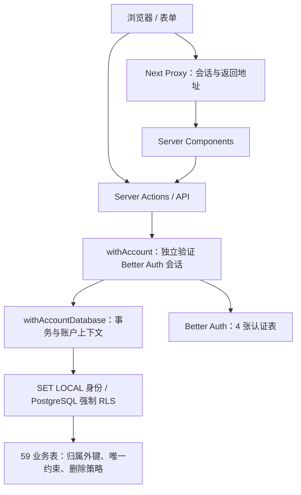

# RuleLoop 账号版架构（2026-09-30）

## 架构对比

| 层面 | 原项目 | v0 导出 | 本次整合 |
|---|---|---|---|
| 页面 | 7 个 Mock 页面 | 64 个页面入口 | 全部保留，加 3 个旧地址兼容入口 |
| 目录／包管理 | src、npm | 根目录 app、pnpm | src/app、src/components、src/lib，npm |
| 运行框架 | Next 16.2.10、React 19.2.4 | 不同依赖组合 | 保留当前框架版本，固定依赖 |
| 数据库 | 5 张未接入的 SQLite 表定义 | PostgreSQL 63 表、零散建表脚本 | src/db 单一入口，2 份版本化迁移 |
| 认证 | Mock | Better Auth | 实际注册／登录／退出，HTTP 与 HTTPS Cookie 配置 |
| 数据隔离 | 不适用 | 大量 action 手工过滤 | 服务端鉴权 + 59 张表强制 RLS + 47 组同账户复合外键 |
| 多步写入 | 不持久化 | 部分多步操作缺事务 | 每个服务端业务入口建立账户事务，失败回滚 |
| 界面 | 旧原型 | 新深色界面 | 保留新视觉；修复溢出、输入丢失、状态恢复、语言切换 |
| 质量门禁 | TypeScript 通过，ESLint 有警告 | 静态审查 | 类型、零警告 lint、构建、单元／数据库／浏览器回归 |

## 请求与数据路径

`src/db/index.ts` 用 AsyncLocalStorage 将每个操作绑定到认证账户和事务。普通业务查询不能脱离账户上下文使用 `db`。事务中的身份设置为 transaction-local，不会残留在连接池中。账号级 advisory lock 串行化同一账号的初始化及读改写；不同账号可并行。嵌套 action 复用上下文，显式嵌套事务使用 savepoint。抛异常以及返回 `{ error }` / `{ ok: false }` 都会回滚外层事务。

`src/lib/action.ts` 是业务 action／API 包装入口；认证路由由 Better Auth 自行处理。页面访问保护只是第一层，业务 action 并不依赖调用页面已经检查过登录。API 错误不会泄露数据库细节。

## 数据完整性

- `drizzle/0000_initial_online_schema.sql`：完整 63 表、账号索引及自然唯一键。
- `drizzle/0001_account_integrity.sql`：59 个业务所有者外键、FORCE RLS、47 组 `(关联 id, userId)` 复合外键；多态关联通过触发器检查归属。
- 所属子记录级联删除；独立规则、消费或其他跨模块记录保留，删除失效来源时仅解除关联。精确关系表见 `upgrade/relationships.json`。
- 偏好、每日记录、单次复盘、目录种子与幂等键按其自然范围去重。幂等键按账户分区。
- 运行角色不得拥有 superuser/BYPASSRLS。迁移和运行 URL 必须指向同一数据库。迁移角色凭据只给部署迁移过程；浏览器不可访问任何数据库凭据。
- 不使用 `drizzle-kit push` 绕过版本化迁移。生成新 schema 迁移后，必须另外检查自定义 RLS／多态归属／删除触发器；这些由第二份 SQL 管理，不能仅依赖 Drizzle 自动推导。

## 工程与模块

`src/app/actions/` 保留业务 Server Actions 调用方式；`src/app/api/` 保留既有 API 路径；`src/components/` 负责客户端表单与交互；`src/lib/` 保存领域规则、金额与日期计算；`src/db/schema.ts` 是表定义入口。金额換算使用定点汇率与整数分，保存当时的换算快照。校验失败和网络失败保留表单输入，成功后再清空或跳转。

AI 翻译先鉴权、校验输入和服务配置，设置 20 秒超时、不自动重试。真实密钥不进入前端。界面翻译保持本地词典；标题观察器避免相同内容反复写入。112 个字体子集已本地化，校验值及许可证在 `public/fonts/`。

默认日期边界为 Asia/Bangkok，可通过 `NEXT_PUBLIC_APP_TIME_ZONE` 统一配置。节律的服务端初始状态和浏览器时间采用同一设置。外部提供商、生产 HTTPS、邮件送达、负载能力并未以本地测试替代实际验收。

原架构文档保存在 [历史版本](history/ARCHITECTURE-before-account-upgrade.md)。独立 `website/` 项目有自己的依赖和 TypeScript 路径，本应用不会扫描或修改它。

## 支出审核任务

`0005_spending_review_hermes` 为支出记录加账户级提交幂等键，新增 `spending_review_jobs`。任务以支出记录 ID 为主键，复合归属外键级联删除，并启用 FORCE RLS。提交与入队在 `withAccountDatabase` 的同一事务提交。冷静期和夜间窗口通过现有风险引擎与应用时区计算。

专用 worker 通过 PostgreSQL 会话锁每库串行处理任务。领取时保存唯一租约，每 10 秒续期，进程崩溃后过期租约会在下一次启动时标记中断。网络请求发生在数据库事务之外。回写匹配当前任务租约，重试递增尝试次数，过期或被删除的任务无法写入。worker 的数据库角色只读取审核任务、更新执行状态与结果字段。人工决定仍通过账户事务检查审核成功和业务状态。

部署配置使用私有 Docker 网络上的专用 Hermes 服务，受控转发器只向同机 Ollama 转发固定模型的文本请求。模型返回经过协议、模型标识和结构校验后才可展示。建议原文与用户决定分开存储。详情和列表共用一个工作区，页面可见时刷新活动审核。旧 GPT 回填与 Markdown 路径保留，回填动作检查记录阶段，避免跳过冷静期或覆盖 Hermes 流程。[需求](PRD-SPENDING-REVIEW.md) · [部署](../deploy/RUNBOOK.md#spending-review-worker-and-hermes)

## 事件复盘 AI Agent 增量规划（2026-10-31，待评审）

[AI Agent 叠加方案](AI-AGENT-OVERLAY.md) 以本账号应用为基线，复用既有事件、复盘、规则、验证、卡片及成长档案。Hermes 规划为服务端执行适配，不另建产品主线或账号体系。该文档描述待实现方案，不代表已接入真实模型或已部署；独立 v7 学习预览未获流程确认，不作为生产架构基线。
